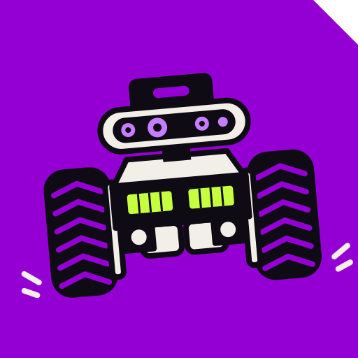
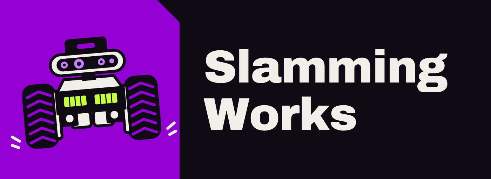

# Slamming Works brand style guide

Version 1.0, 9 October 2026.

Slamming Works is the umbrella name for all hobby projects: robotics, drones, electronics and firmware. This guide sets the name, palette, type, voice and rules so every project looks like it came from the same bench.

## Summary

| Item | Standard | Status |
| --- | --- | --- |
| Name | Slamming Works | Final |
| Scope | Robotics, drones, electronics, firmware | Final |
| Main color | Slam Violet `#9400D3` | Final |
| Palette | Night shift (dark first) | Final |
| Handle and prefixes | `slamworks`, `slw_` | Final, availability not yet checked |
| Fonts | Archivo, IBM Plex Sans, IBM Plex Mono | Final |
| Logo | Rover mark and Slamming Works lockup | Final |
| Positioning line | Three candidates | Open |

Open items are listed at the end of the guide.

## Brand and naming

**What it is.** Slamming Works is the workshop name behind every hobby project: robots, drones, boards and firmware. It reads as a bench, not a company: dry, hands-on, honest about what breaks.

**Name meaning.** Slam: to hit hard, and SLAM, the mapping technique used in robotics. Works: a workshop, and a claim each project has to back up with evidence.

**Positioning line candidates:**

1. Things get slammed here, then documented.
2. Build it. Hit the wall. Read the log.
3. A workshop for robots that crash on purpose.

**Personality.** Dry, hands-on, a little self-deprecating, specific. Not corporate, hype-driven, mascot-led, or an "AI company".

### Umbrella structure

| Level | Pattern | Rule |
| --- | --- | --- |
| Umbrella | Slamming Works, `slamworks` | One org and one handle on every platform |
| Project | `<codename>` | One word, concrete, easy to type |
| Part | `<codename>-<part>` | For example motor, nav, firmware, board |
| Revision | `rev-a`, `v0.3.0` | Letters for hardware, semantic versions for software |

**Codename rules.** One lowercase word, 4 to 8 letters, a concrete noun or an impact verb. Nothing that needs a pun explained. Nothing that matches an existing product. The sound to aim for: thud, clunk, bonk, skid, wedge. These are examples only and have not been checked for availability.

### Handles and prefixes

| Surface | Convention | Example |
| --- | --- | --- |
| GitHub org or username | `slamworks` (fallback `slam-works`, `slamworks-dev`) | github.com/slamworks |
| Repos | `<codename>`, with `slamworks-` only when the name is ambiguous | `thud` |
| ROS packages | `slw_<codename>_<part>`, snake\_case | `slw_thud_nav` |
| Python / PyPI | `slamworks-<codename>`, imported as `slamworks.<codename>` | `slamworks-thud` |
| npm | scoped: `@slamworks/<codename>` | `@slamworks/thud` |
| C / C++ firmware | `slw_` on functions, `SLW_` on macros | `slw_motor_init()`, `SLW_CONFIG_H` |
| Docker images | `slamworks/<codename>-<tag>` | `slamworks/thud-ros` |
| Hardware boards | `slw-<codename>-rev-<letter>` | `slw-thud-rev-a` |
| Release tags | Semantic versions | `v0.3.0` |

**Collisions to avoid**

- A bare `slam_` prefix reads as a mapping package, and ROS already has `slam_toolbox` and `slam_gmapping`. Always use `slw_`.
- `sw_` reads as "software". Use `slw_` or the full `slamworks`.
- Short names are often taken. Check GitHub, PyPI, npm, domains and X before registering anything.

## Palette

The palette is Night shift: dark first, with violet for fills and one accent. It suits video, dark READMEs and bench monitors.

| Role | Name | Hex | Use |
| --- | --- | --- | --- |
| Main | Slam Violet | `#9400D3` | Fills, blocks, borders on large shapes |
| Main tint | Ultraviolet | `#C77DFF` | Violet text, links and icons on dark |
| Neutral | Night | `#0E0B14` | Page background |
| Neutral | Paper | `#F2EFE8` | Body text on dark, background for print |
| Accent | Acid Lime | `#C6FF3D` | One moment per screen |

Proportions: about 55% Night, 25% Violet family, 15% Paper, 5% Lime.

### Rules

- Slam Violet is a fill or a large color block. It fails as text on Night (2.97:1), so violet text, links and icons on dark use Ultraviolet.
- One accent moment per screen. An accent that shows up everywhere stops being an accent.
- Flat fills only: no gradients, glow or glass. Flat color reads as painted metal and stenciled signage.
- Secondary text uses Ultraviolet or Paper, never a pale grey. Grey on dark is the most common contrast failure.
- Light surfaces (print, stickers, PDFs) use Paper as the background with Night text. Slam Violet works as a fill or link there.
- Lime on Violet passes AA, but keep it to large labels.

### Contrast

WCAG 2 ratios, calculated for these exact hex values.

| Pairing | Ratio | Verdict |
| --- | --- | --- |
| Paper on Night | 17.0:1 | Pass |
| Lime on Night | 16.5:1 | Pass |
| Night on Lime | 16.5:1 | Pass |
| Ultraviolet on Night | 7.2:1 | Pass |
| Night on Ultraviolet | 7.2:1 | Pass |
| Paper on Violet | 5.7:1 | Pass |
| Violet on Paper | 5.7:1 | Pass |
| Lime on Violet | 5.6:1 | Pass |
| Violet on Night | 3.0:1 | **Fail for text.** Fills only, outlined with Ultraviolet |
| Ultraviolet on Violet | 2.4:1 | **Fail.** Do not combine |

### Tokens

```css
:root {
  --slw-main: #9400D3;   /* Slam Violet: fills, blocks */
  --slw-tint: #C77DFF;   /* Ultraviolet: text and links on dark */
  --slw-night: #0E0B14;  /* page background */
  --slw-paper: #F2EFE8;  /* body text on dark */
  --slw-accent: #C6FF3D; /* Acid Lime: one moment per screen */
}
```

## Visual system

### Typography

| Use | Typeface | Reason |
| --- | --- | --- |
| Headings | Archivo, weights 800 to 900 (expanded width where available) | Heavy, wide letterforms echo stenciled labels on equipment. |
| Body | IBM Plex Sans | Neutral and readable at length. Sits well beside Archivo. |
| Code, part numbers, small labels | IBM Plex Mono | Matches how engineers read logs. Small sizes only, never headings. |

- Body size 17 to 18px, line height about 1.55. Headings tight, line height about 1.1.
- Sentence case everywhere. No uppercase labels with wide letter-spacing.
- Fallbacks: `system-ui, sans-serif` and `ui-monospace, monospace`.
- All three families are published under the SIL Open Font License. Confirm the license of the exact files before self-hosting or embedding.

### Logo

The logo is a front-view cartoon of the real rover, tilted 5 degrees counterclockwise as if it just landed, with small impact marks by the wheels. It is drawn in the brand palette: Paper body and depth camera, a Night lidar and bumper, Night wheels with violet chevron tread, Ultraviolet camera lenses, and the Acid Lime light bars as the accent.





| Version | Use | File |
| --- | --- | --- |
| Mark | Avatars, favicons, stickers, social profile images | `slamming-works-logo/slw-mark.svg` |
| Lockup | Website header, README banners, social previews, slides | `slamming-works-logo/slw-lockup.svg` |
| Lockup, light | Print, PDFs and other light surfaces | `slamming-works-logo/slw-lockup-light.svg` |
| PNG and favicon exports | Mark at 32 to 1024px, both lockups at 1400 and 2800px, `favicon.ico` (16, 32, 48px) | `slamming-works-logo/export/` |

The SVGs are generated by `gen_logo.py` in the same folder. Change the script and rerun it; do not edit the SVGs by hand. The wordmark is outlined from Archivo Black, so the SVGs do not need the font installed. Rerunning the script needs Python with `fonttools` and the Archivo Black font installed; without them it falls back to live text. Re-export the PNGs after any change. Earlier drafts are kept in `slamming-works-logo/v1-front` to `v7-full-name` for reference only.

**Rules**

- The wordmark always reads **Slamming Works**, set in Archivo Black, on two lines in the lockup. The handle `slamworks` is for accounts and code, never the wordmark.
- The mark always sits on its violet tile with the cut top-right corner. Do not place the rover on any other background.
- The lockup sits on Night. On light surfaces, keep the violet tile and set the wordmark in Night on Paper.
- Clear space equals the size of the tile's cut corner (one eighth of the tile width) on every side.
- Minimum size: mark 32px on screen, 10mm in print. Use 48px or larger where the camera lenses should stay readable.
- The mark's tilt counts as the knock on any screen it appears on. Do not tilt anything else next to it.
- Do not recolor, rotate, mirror, stretch or add effects to the logo. No gradients, glow or drop shadows.

### Shape, border and shadow

- **Corners:** radius 0 by default, 4px on form inputs. Primary buttons get one chamfered corner of about 8px. No pill shapes. Robots are machined parts, not bubbles.
- **Borders:** 2px solid Paper on Night, Night on Paper for light surfaces.
- **Shadow:** one hard offset shadow, `4px 4px 0`, on interactive elements only. Violet on dark, Night on light. No blurred shadows. It doubles as press feedback when the element moves toward it.
- **Textures and patterns:** none by default. A pattern needs a written reason tied to a specific project.

### Identity motif: the knock

One element per composition sits rotated up to 3 degrees or nudged off the grid, as though it just got hit. One repeated gesture makes the brand recognizable without decoration.

- At most one knocked element per screen.
- Never on body text or interactive controls. Rotation hurts reading and click targets.
- It is the only recurring gimmick. Used everywhere, it becomes noise.

### Imagery and icons

- Real photos and video of builds and tests, shot on the bench in natural light.
- Screenshots of RViz, maps and logs. PCB renders and schematics exported from KiCad.
- Every image has a caption saying what it shows, with the date when it matters.
- No stock photos, Undraw or Storyset illustrations, 3D blob characters or generated robot images. Any of them could belong to any brand.
- Prefer text labels over icons. When icons are needed, use one small set with 2px square-ended strokes to match the borders, each mapping to a real thing (battery, motor, connector, camera).
- Never use sparkle, star, magic, lightning or robot-head icons as feature markers.

### Layout

- One focal point per screen. Everything else defers to it.
- Sections change shape because the content changes: a full-width log excerpt, a photo that bleeds to the edge, a two-column spec sheet, a build timeline.
- Section order follows the story: what it is, proof it works, how it is built (BOM, schematics, firmware), where to get the files, the build log.
- 8px base unit. Whitespace separates sections; it is not leftover space.
- Do not use bento grids, three identical feature cards, a numbered three-step "how it works", a "trusted by" logo bar, a three-column pricing table or a four-column template footer.
- Add FAQ and pricing sections only when real questions or a real price exist.

### Motion

Motion is reserved for physical moments. Three behaviors are allowed:

1. **Button press:** the element moves 2px toward its hard shadow, as physical feedback.
2. **Landing:** the hero element drops in once, 200ms, ease-out, with one small settle. It expresses "slam" once and only once.
3. **Smooth anchor scrolling,** for orientation on long pages.

No fade-up on every element, no floating or bounce loops, no scale-on-scroll. All motion switches off under `prefers-reduced-motion`.

## Voice

### Principles

1. **Say the specific thing.** Name the board, the sensor, the failure. If a sentence could describe any product, rewrite it.
2. **Show evidence, not claims.** Link the log, the video, the commit or the schematic.
3. **Report failure plainly.** "It tipped over at the second turn" beats "still being refined".
4. **Dry humor, sparingly.** One joke per page at most, never at the reader's expense.
5. **Sentence case everywhere.**

### Hard rules

- **No em dashes.** Use a comma, period, colon or parentheses.
- **No unsourced numbers.** If a figure has no measurement behind it, leave it out. When there is one, say how and where it was measured and link the raw data.
- **No testimonials** unless they are real, attributed and permitted.
- **No security, compliance or performance claims** without evidence that can be linked.
- **No fake terminal windows** as decoration. A code block is fine when it shows real output.

**Words to avoid:** AI-powered, next-generation, revolutionary, seamless, cutting-edge, intelligent, ultimate, powerful, effortless, blazing fast. Say what the thing does.

### Calls to action

| Instead of | Write |
| --- | --- |
| Get started | Clone the repo |
| Learn more | Read the build log |
| Explore | Browse the schematics |
| Try now | Flash the firmware |
| Discover | Watch the crash test |

### Before and after

Illustrative copy. Replace bracketed values with real facts.

| Before | After |
| --- | --- |
| A seamless, next-generation motor controller. | A motor controller board for ROS, built around an STM32. Schematics and firmware are in the repo. |
| Blazing fast and 99.9% reliable. | Measured: \[real data\] over \[test setup\]. Raw logs linked. |
| Trusted by makers worldwide. | (Delete it. No evidence, no line.) |

## Applications

### README template

Every repo README follows this order:

1. What it is, in one sentence.
2. Demo: a video or GIF of the real thing.
3. Hardware: BOM and schematic links.
4. Build and run: commands that work.
5. Status: **Works**, **Partly works** or **Broken** (link to the issue). Honest status is part of the voice.
6. License.

### Other surfaces

| Surface | Rule |
| --- | --- |
| GitHub profile and org | Bio: "Building robots that hit things, then logging why. ROS, STM32, drones." Keep it true to current projects. |
| Social preview (1280 x 640) | Night background, logo, one real photo, one accent block. No stock art. |
| Website and blog | Navigation lists only pages that exist: Projects, Build logs, About, Source. A control that cannot work yet is removed or labeled "Coming soon". |
| Post and video titles | State the event: `<project>: <what happened>`. |
| Video thumbnails | A real frame, with Paper text on a Night block. |
| Hardware silkscreen | `SLAMWORKS`, the project name and the revision letter. |
| Stickers | The mark on its violet tile, die-cut along the tile with the chamfered corner. |

## Quality

### Accessibility baseline

- **Contrast:** WCAG AA minimum everywhere (4.5:1 for normal text, 3:1 for large text and UI components). Use the contrast table above.
- **Links:** always underlined. Ultraviolet on Night, Violet on Paper.
- **Focus:** a visible 3px ring on every focusable element. Acid Lime on Night, Night on Paper. Never remove an outline without replacing it.
- **Keyboard:** everything reachable with Tab, activated with Enter or Space, dialogs closed with Escape.
- **Mobile:** no horizontal scroll, tap targets at least 44px, code blocks and tables scroll inside their own container.
- **Media:** alt text on images, captions or transcripts on video.
- **Motion:** respect `prefers-reduced-motion`.
- **States:** every view that loads data has empty, loading and error states.

### Pre-release checklist

Every answer should be "no".

- Is there an em dash anywhere in the copy?
- Is there a number, testimonial, security claim or performance claim without a real source?
- Does any navigation link point to a page that does not exist?
- Does any button, form or control do nothing, without a visible "Coming soon"?
- Is any text below WCAG AA contrast?
- Is any part of the page unusable by keyboard, or missing a visible focus ring?
- Does the layout overflow or break on a phone?
- If there is a theme toggle, does either theme break?
- Does any section exist only because landing pages usually have one?
- Is the logo below minimum size, recolored or missing its violet tile?
- Would the page look generic with the logo removed?
- Does it look like a clone of another well-known product?
- Has any page or control gone untested before release?

### Decision log

| Decision | Reason |
| --- | --- |
| Name: Slamming Works | "Works" suits an umbrella and carries the "it works" proof claim. |
| Main color `#9400D3` | Owner's choice. 5.7:1 as a fill or link on Paper. |
| Night shift palette | Dark first suits video, dark READMEs and bench monitors. Two light-first alternatives (Hazard yellow, Workshop orange) were rejected for that reason. |
| Violet never as text on dark | It fails at 2.97:1 on Night. Ultraviolet does that job at 7.2:1. |
| Flat palette, one accent | A recognizable look from few colors, with no gradients to date the design. |
| Acid Lime once per screen | 16.5:1 on Night, so it works as text or fill. Keeping it rare keeps it meaningful. |
| Archivo for headings | Heavy, wide forms echo equipment stencils. |
| IBM Plex Sans and Mono | Readable for long documentation and familiar to engineers. |
| Radius 0 with one chamfered corner | Reads as machined parts and avoids the pill-shaped default. |
| Hard offset shadow, no blur | Doubles as press feedback and avoids floating-card shadows. |
| The knock motif | One repeated gesture specific to the name. |
| Rover mark as the logo | Drawn from the real rover, so it could not belong to any other brand. The front view stays readable down to avatar size, and the tilt and impact marks say "slam". |
| Real photos only | Stock and generic illustration could belong to any brand. |
| Honest status labels in READMEs | Matches the voice and builds trust with builders. |
| No stats, testimonials or compliance claims | None are verifiable today, so none appear. |
| `slw_` prefix, never `slam_` | `slam_` reads as an existing ROS mapping package. |

### Open items

1. **Positioning line:** choose one of the three candidates.
2. **Name availability:** check `slamworks` on GitHub, PyPI, npm, domains and X, and register it.
3. **First codename:** name the first project under Slamming Works.
4. **Light web theme:** decide whether the web needs a light theme, or stays dark-only with light print surfaces.
